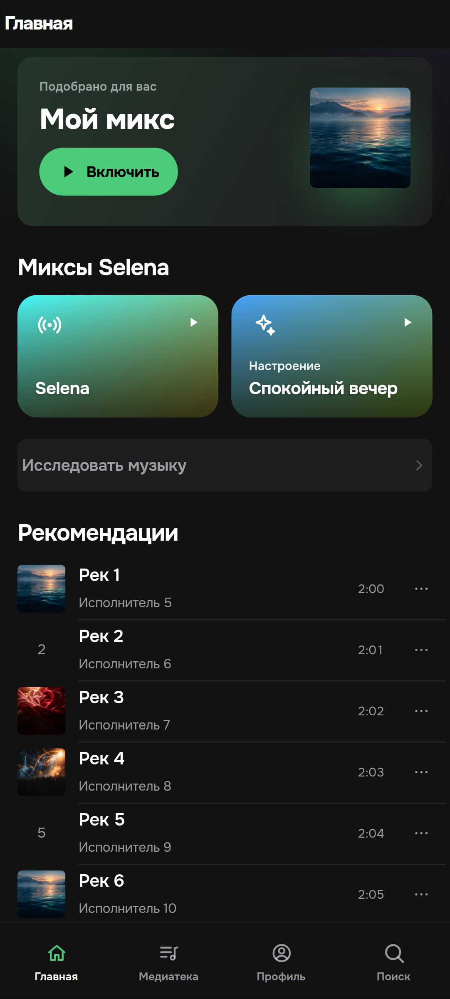
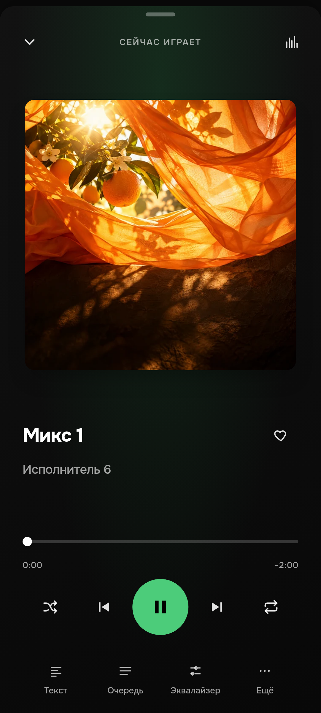
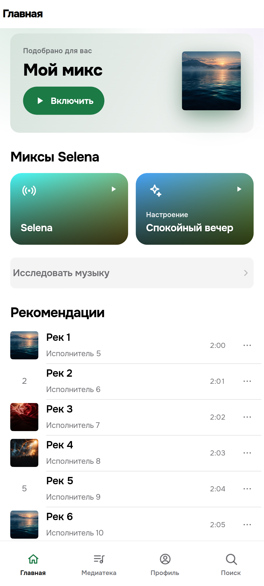
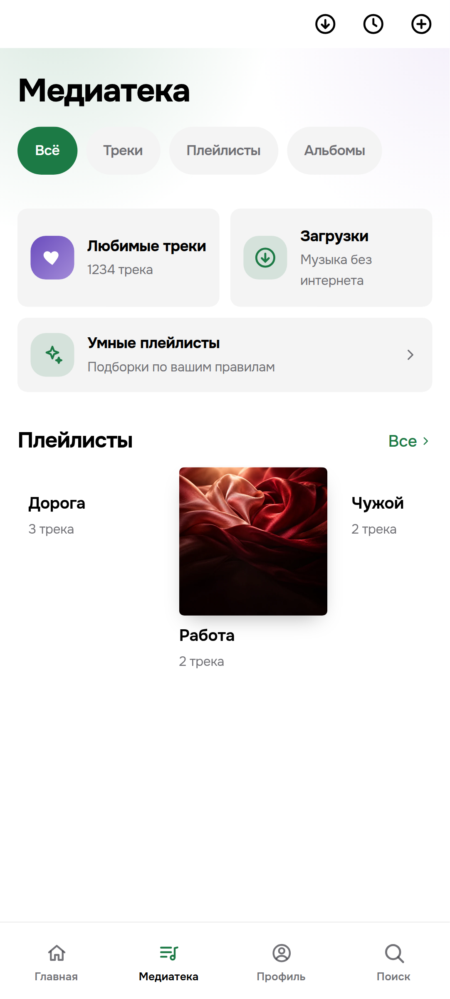
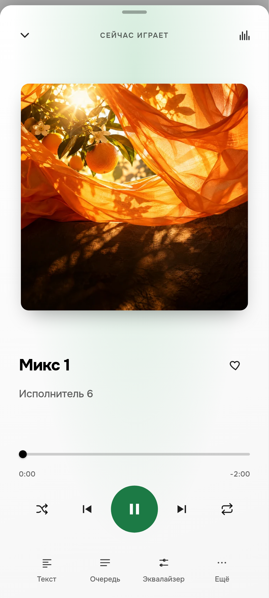
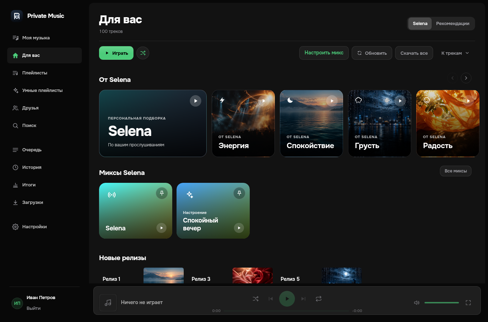

# Private Music

**VK Музыка на компьютере и Android — с офлайн-загрузками, текстами песен и настройкой звука.**

[Скачать приложение](https://github.com/decoder-dev/PrivateMusicDesktop/releases/latest) · [Все выпуски](https://github.com/decoder-dev/PrivateMusicDesktop/releases) · [Сообщить о проблеме](https://github.com/decoder-dev/PrivateMusicDesktop/issues)

Windows · macOS · Linux · Android

Private Music — неофициальный клиент VK Музыки. Слушайте свою библиотеку, находите новые
треки, сохраняйте музыку для прослушивания без сети и настраивайте звучание под себя.
На компьютере приложение использует широкую раскладку, на Android — интерфейс с нижней
навигацией, жестами и полноэкранным плеером.

  
  

*Превью интерфейса версии 0.x на тестовых данных.*

Светлая тема и интерфейс компьютера

  
  
  

## Что умеет приложение

- **Музыка VK.** Библиотека, поиск, рекомендации, миксы и список новых релизов.
- **Плеер.** Очередь, перемотка, регулировка громкости и компактная панель.
- **Офлайн.** Сохранение треков и воспроизведение загрузок без сети.
- **Тексты песен.** Просмотр текста текущего трека.
- **Android.** Фоновое воспроизведение и управление из уведомления.

Доступность музыки и рекомендаций зависит от аккаунта, региона и ответов VK.

## Как установить

Откройте [последний выпуск](https://github.com/decoder-dev/PrivateMusicDesktop/releases/latest)
и выберите файл для своей системы:

- **Windows x64:** `PrivateMusic_<версия>_windows-x64.msi`. Запустите установщик
  и откройте приложение через ярлык PrivateMusic.
- **macOS:** `PrivateMusic_<версия>_macos-arm64.dmg` для Apple Silicon или
  `PrivateMusic_<версия>_macos-x64.dmg` для Intel. Перетащите приложение из образа в «Программы».
- **Debian / Ubuntu x64:** `PrivateMusic_<версия>_linux-amd64.deb`.
  Откройте пакет системным установщиком или установите через `sudo apt install ./имя-файла.deb`.
- **Android, ARM64:** `PrivateMusic_<версия>_android-arm64.apk`.
  Откройте APK на телефоне и разрешите установку из выбранного браузера или файлового менеджера.

Установщики для ПК пока не имеют сертификата доверенного издателя Windows или нотариализации
Apple, поэтому ОС может показать предупреждение. APK Android подписан ключом приложения.
`SHA256SUMS.txt` содержит контрольные суммы установщиков.

В репозитории также есть установочные скрипты: `install.ps1` для Windows и `install.sh`
для macOS/Linux. Они скачивают выпуск и проверяют его SHA-256.

## Обновления

Скачайте установщик новой версии со страницы релиза. В Windows запустите MSI, в macOS
замените приложение в «Программах», в Linux установите новый DEB, а в Android откройте новый APK.

## Вход и данные

На Android вход выполняется через отдельное окно VK. На компьютере экран «Профиль»
принимает данные существующей сессии. Секреты сохраняются в системном хранилище, на Android
используется Android Keystore. Локальные загрузки и история находятся в папке данных приложения.

## Если что-то не работает

Создайте [issue](https://github.com/decoder-dev/PrivateMusicDesktop/issues) и укажите:
систему и её версию, версию Private Music, последовательность действий и ожидаемый результат.
Для проблемы интерфейса приложите снимок экрана, для сбоя воспроизведения — журнал диагностики.
Пароли, токены и содержимое системного хранилища прикладывать не нужно.

## Разработка и документация

ПК и Android разрабатываются вместе в ветке **`main`**. Выпуски 1.x используют
Compose Multiplatform и движок на Rust. Код прежней оболочки Tauri находится в `src-tauri/` и `ui/`.
Код обработки аудиопотоков в `native/` используется совместно с
[версией для iPhone](https://github.com/decoder-dev/PrivateMusic2).

- [Концепт мобильного плеера](docs/mobile-player-concept.md)
- [Сборка и устройство Android-версии](docs/android.md)
- [Возможности линейки 0.6](docs/features-0.6.md)
- [Сборка и публикация обновлений](docs/updates.md)

Для Compose нужны Rust, JDK 17 и Gradle 9.5.0. В папке `compose/` команда
`gradle :composeApp:desktopTest` запускает тесты, а `gradle :composeApp:run` открывает приложение.
Для Android нужны SDK 36 и NDK 27.2.12479018. Релизы собираются в GitHub Actions из тега
`v<версия>`, совпадающего с версиями в `compose/composeApp/build.gradle.kts` и
`compose/androidApp/build.gradle.kts`.

Private Music не является официальным приложением VK и не связан с VK.
