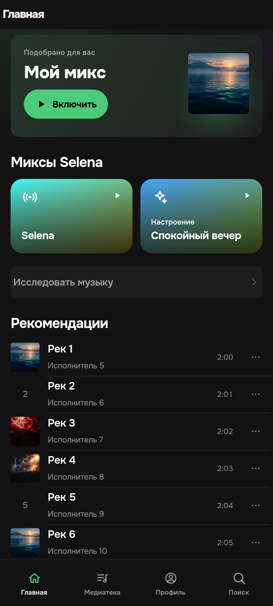
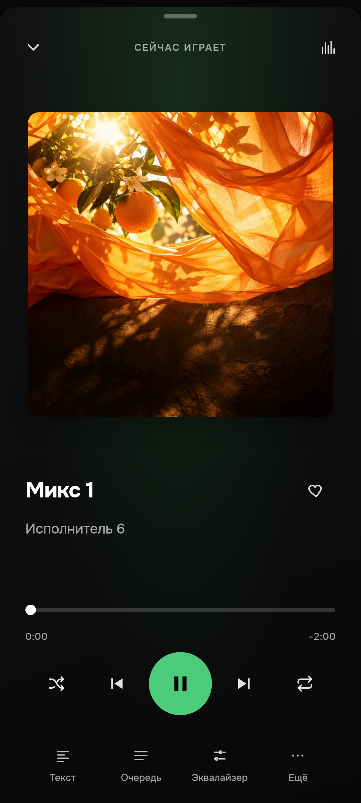
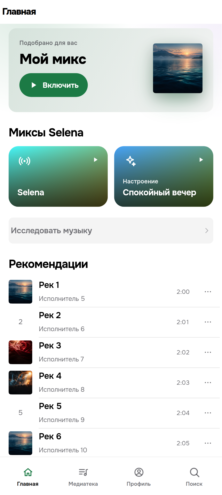
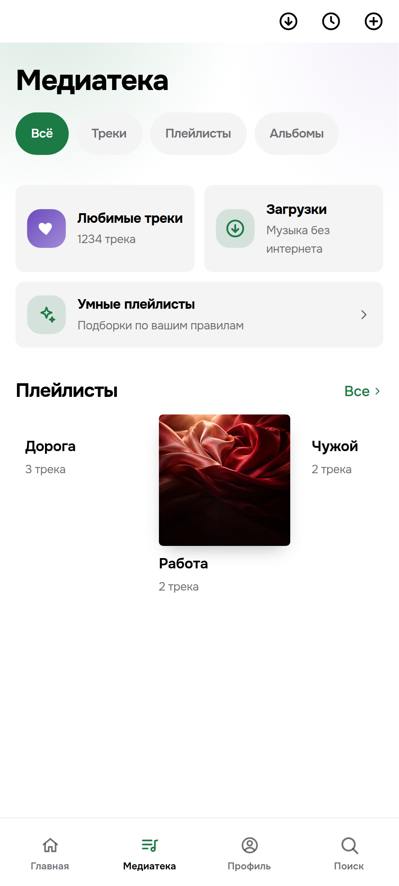
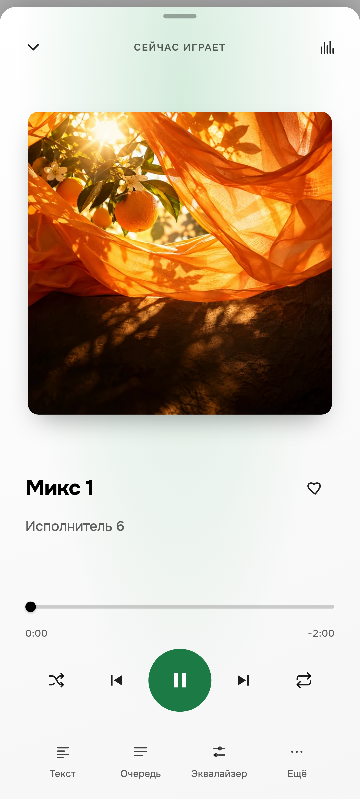
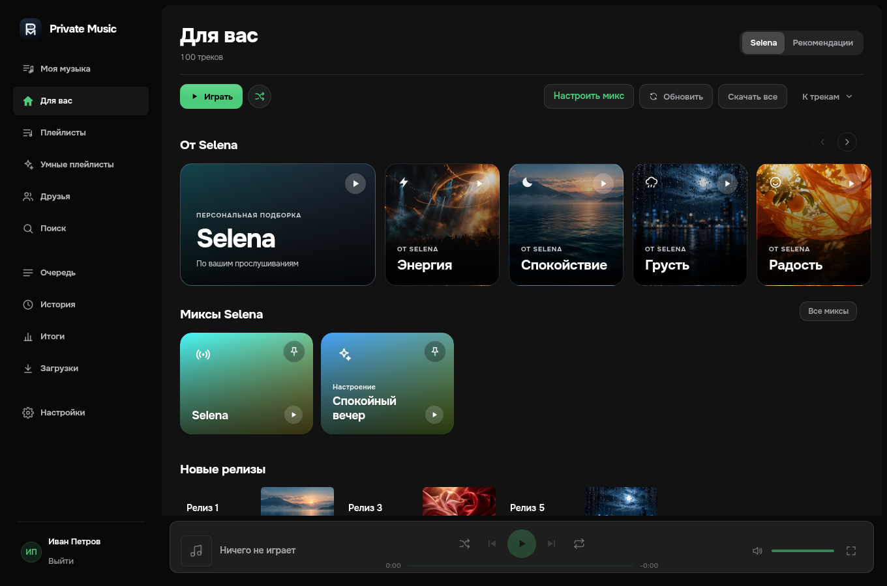

# Private Music

**VK Музыка на компьютере и Android — с офлайн-загрузками, текстами песен и настройкой звука.**

[Скачать приложение](https://github.com/decoder-dev/PrivateMusicDesktop/releases/latest) · [Все выпуски](https://github.com/decoder-dev/PrivateMusicDesktop/releases) · [Сообщить о проблеме](https://github.com/decoder-dev/PrivateMusicDesktop/issues)

Windows · macOS · Linux · Android

Private Music — неофициальный клиент VK Музыки. Слушайте свою библиотеку, находите новые
треки, сохраняйте музыку для прослушивания без сети и настраивайте звучание под себя.
На компьютере приложение использует широкую раскладку, на Android — интерфейс с нижней
навигацией, жестами и полноэкранным плеером.

  
  

*Превью интерфейса на тестовых данных. Фотографии в превью заменяют обложки тестового каталога.*

Светлая тема и интерфейс компьютера

  
  
  

## Что умеет приложение

- **Музыка и поиск.** Ваша библиотека, плейлисты, альбомы, исполнители, музыка друзей,
  рекомендации VK и персональные миксы Selena.
- **Удобный плеер.** Очередь, перемешивание, повтор, таймер сна, непрерывные переходы
  и плавное сведение треков.
- **Звук под вас.** Десятиполосный эквалайзер, готовые пресеты, предусиление,
  нормализация громкости, сжатие динамического диапазона и расширение стерео.
- **Музыка без интернета.** Загрузка треков и плейлистов, синхронизация офлайн,
  автоматическое сохранение избранного и управление кэшем.
- **Тексты песен.** Синхронные строки, сохранённые тексты, личные правки и копирование.
- **Порядок в библиотеке.** Умные плейлисты, закреплённые подборки, массовые действия,
  история прослушиваний и личная статистика.
- **Оформление.** Светлая и тёмная темы, размер текста, несколько видов плеера.
- **Android.** Фоновое воспроизведение, управление из уведомления и с экрана блокировки,
  кнопки гарнитуры и Bluetooth, системная отправка аудиофайлов.
- **Компьютер.** Системные медиаклавиши, трей, отдельное мини-окно плеера и выбор
  устройства вывода.

Доступность музыки и рекомендаций зависит от аккаунта, региона и ответов VK.

## Как установить

Откройте [последний выпуск](https://github.com/decoder-dev/PrivateMusicDesktop/releases/latest)
и выберите файл для своей системы:

- **Windows x64:** `PrivateMusic_<версия>_windows-x64-setup.exe`. Запустите установщик.
  Приложение устанавливается для текущего пользователя.
- **macOS, Apple Silicon и Intel:** `PrivateMusic_<версия>_macos-universal.dmg`.
  Откройте образ и перетащите приложение в «Программы».
- **Debian / Ubuntu x64:** `PrivateMusic_<версия>_linux-amd64.deb`.
  Откройте пакет системным установщиком или установите через `sudo apt install ./имя-файла.deb`.
- **Другие дистрибутивы Linux x64:** `PrivateMusic_<версия>_linux-amd64.AppImage`.
  Разрешите выполнение файла в его свойствах и запустите его.
- **Android, ARM64:** `PrivateMusic_<версия>_android-arm64.apk`.
  Откройте APK на телефоне и разрешите установку из выбранного браузера или файлового менеджера.

Установщики для ПК пока не имеют сертификата доверенного издателя Windows или нотариализации
Apple, поэтому ОС может показать предупреждение. APK Android подписан ключом приложения.
Файлы `.sig`, `latest.json` и архив `.app.tar.gz` нужны механизму обновления; для первой
установки выбирайте перечисленные выше файлы. `SHA256SUMS.txt` содержит контрольные суммы.

В репозитории также есть установочные скрипты: `install.ps1` для Windows и `install.sh`
для macOS/Linux. Они скачивают выпуск и проверяют его SHA-256.

## Обновления

В новой версии откройте **Настройки → Обновления → Проверить обновления**.

- **Android:** приложение проверит версию и скачает APK, проверит его контрольную сумму,
  имя пакета и сертификат. Затем Android предложит установить обновление. Если система
  запросит разрешение на установку из Private Music, выдайте его и повторите установку.
- **Windows, macOS и Linux:** приложение скачает пакет, проверит цифровую подпись,
  установит обновление и перезапустится. Для системной установки Linux или защищённой
  папки macOS может потребоваться подтверждение прав.

Обновление запускается вашим нажатием кнопки. Загрузку можно отменить; установленные
данные и вход в аккаунт сохраняются. Старую версию, в которой этого механизма ещё нет,
нужно один раз обновить вручную установщиком из нового выпуска.

## Вход и данные

Вход выполняется через отдельное окно VK. Секреты аккаунта хранятся в системном
хранилище, на Android — с использованием Android Keystore. Локальные загрузки,
история и настройки находятся в папке данных приложения.

Отправка статуса прослушивания и событий в VK включается отдельно в настройках.
Для загрузки обновлений из этого публичного репозитория токен GitHub не нужен.

## Если что-то не работает

Создайте [issue](https://github.com/decoder-dev/PrivateMusicDesktop/issues) и укажите:
систему и её версию, версию Private Music, последовательность действий и ожидаемый результат.
Для проблемы интерфейса приложите снимок экрана, для сбоя воспроизведения — журнал диагностики.
Пароли, токены и содержимое системного хранилища прикладывать не нужно.

## Разработка и документация

ПК и Android разрабатываются вместе в ветке **`main`**. Движок написан на Rust,
оболочка — Tauri 2, интерфейс — JavaScript и CSS, Android-интеграции — Kotlin.
Код обработки аудиопотоков в `native/` используется совместно с
[версией для iPhone](https://github.com/decoder-dev/PrivateMusic2).

- [Сборка и устройство Android-версии](docs/android.md)
- [Возможности линейки 0.6](docs/features-0.6.md)
- [Сборка и публикация обновлений](docs/updates.md)

Для локальной разработки нужны Rust, Node.js и системные зависимости Tauri.
Для Android дополнительно нужны JDK, Android SDK и NDK. Релизы собираются в GitHub Actions
для Windows, macOS, Linux и Android из одного тега `v<версия>`; версия должна совпадать
в `Cargo.toml` и `src-tauri/tauri.conf.json`.

Private Music не является официальным приложением VK и не связан с VK.
